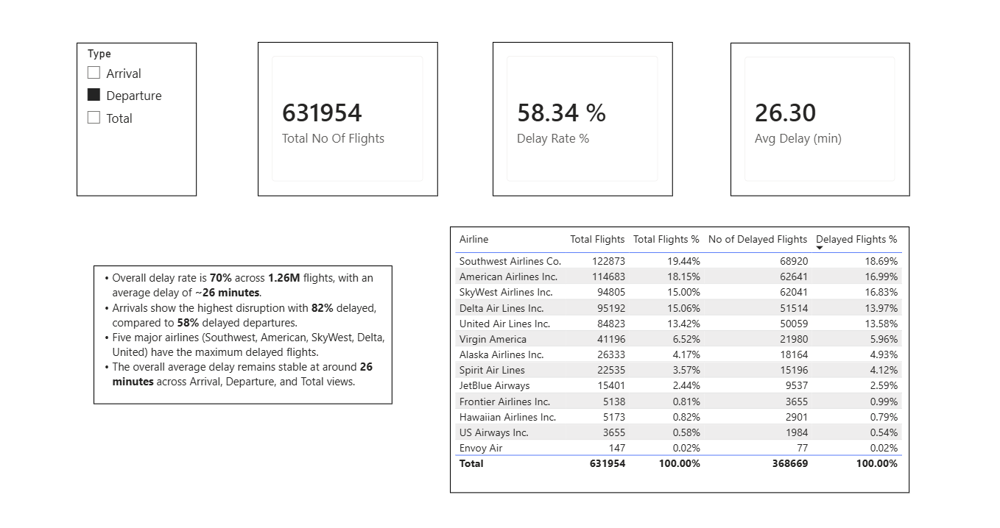
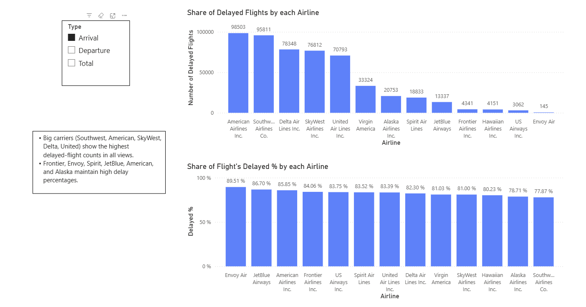
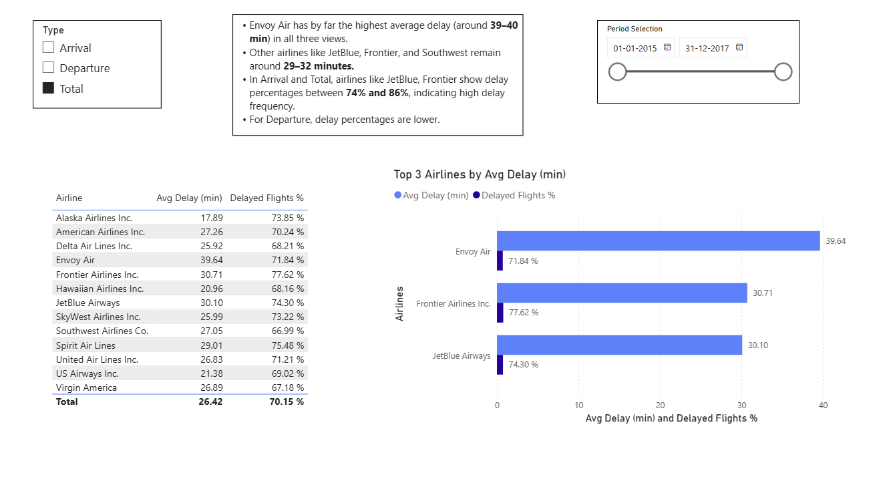
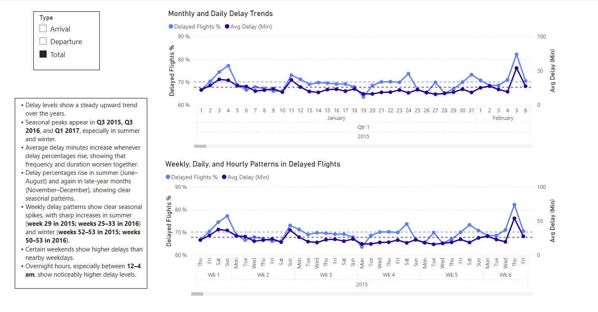

# ✈️ Flight Delay Analysis at Los Angeles International Airport (LAX)

## Project Overview

This project analyzes flight punctuality at Los Angeles International Airport (LAX) using flight data from 2015–2017. The goal was to identify delay patterns, evaluate airline performance, and determine the time periods in which flights are most likely to be delayed. The analysis focuses exclusively on flights arriving at or departing from LAX, while cancelled and diverted flights were excluded to ensure a consistent assessment of operational performance.

## Objectives

- Analyze flight delay trends at LAX.
- Measure airline punctuality and compare carrier performance.
- Identify periods with the highest delay frequency and delay rates.
- Build an interactive Power BI dashboard for exploring arrival and departure delays.

## Dashboard Overview

### Executive Summary

### Airline Performance Analysis

### Delay Trends by Time Period

### Weekly and Hourly Analysis

## 🔗 Links
## Live Dashboard

View the interactive Power BI dashboard here:

[Power BI Dashboard](https://app.powerbi.com/reportEmbed?reportId=c0eefca2-c2ef-4a02-b12d-ff80c69705d6&autoAuth=true&ctid=a0668a0b-7f14-4396-ad4d-0ebf06457115)

- 📁 **PBIX File:** [Download Nitika_Abrol_FinalProject.pbix](https://1drv.ms/u/c/b4a8075ef12c0fc4/IQDS6NgStjL_QJLJKk5ljqnzAYRIa0T-MeDcj4Fd9Ax7Iv8?e=RAdoLk)

## Data Preparation

The data was extracted using SQL and transformed in Power BI. Key preparation steps included:

- Filtering flights to include only LAX arrivals and departures.
- Excluding cancelled and diverted flights.
- Standardizing time columns for accurate time\-based analysis.
- Converting delay values to absolute values to measure deviations from scheduled times.
- Defining a flight as delayed when it deviated from the scheduled time by at least 5 minutes.

## Analysis Performed

### Key Performance Indicators (KPIs)

- Total number of flights
- Airline market share
- Percentage of delayed flights
- Average delay per flight

### Airline Performance

- Identification of the three airlines with the highest average delays
- Comparison of delay rates across airlines

### Time\-Based Analysis

Delay trends were analyzed across:

- Year
- Quarter
- Month
- Calendar Week
- Day of Week
- Hour of Day

The dashboard highlights both periods with the highest number of delayed flights and periods with the highest delay rates.

## Tools & Technologies

- SQL
- Power BI
- Data Cleaning & Transformation
- Exploratory Data Analysis (EDA)
- KPI Development
- Data Visualization

## Key Skills Demonstrated

- Data Extraction with SQL
- Data Cleaning and Transformation
- Business Intelligence Reporting
- KPI Design and Analysis
- Time\-Series Analysis
- Power BI Dashboard Development
- Data Storytelling and Insight Generation

